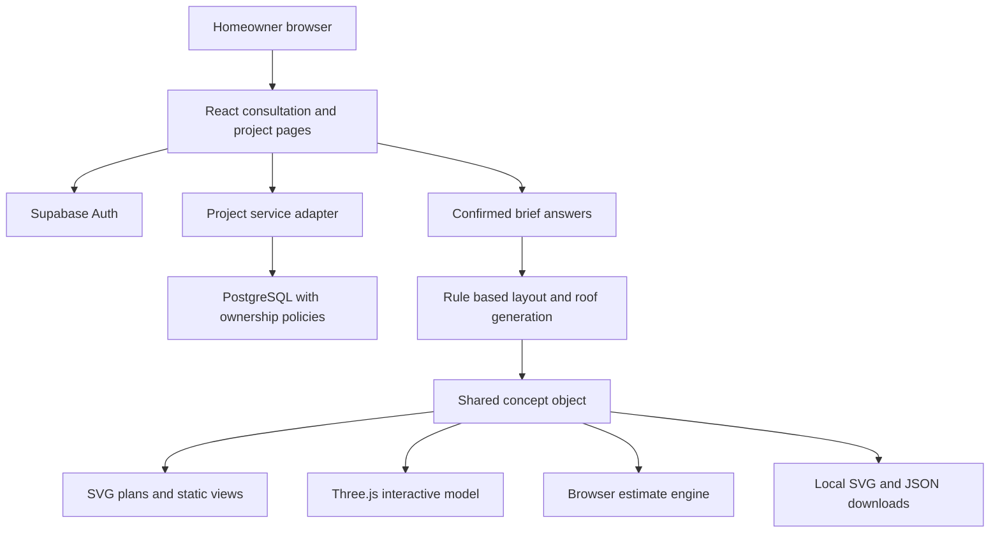
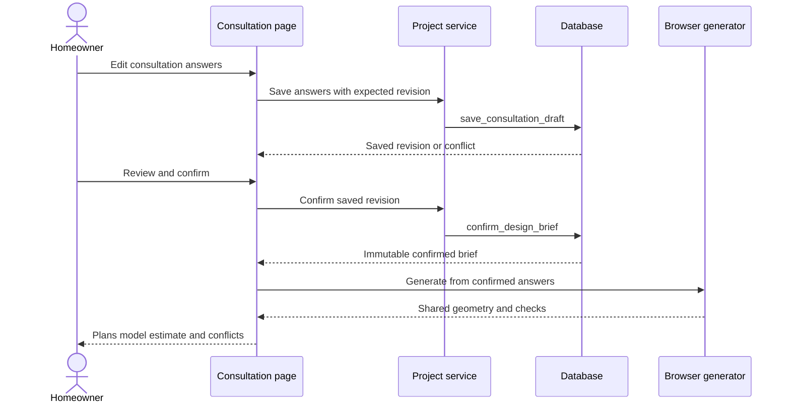
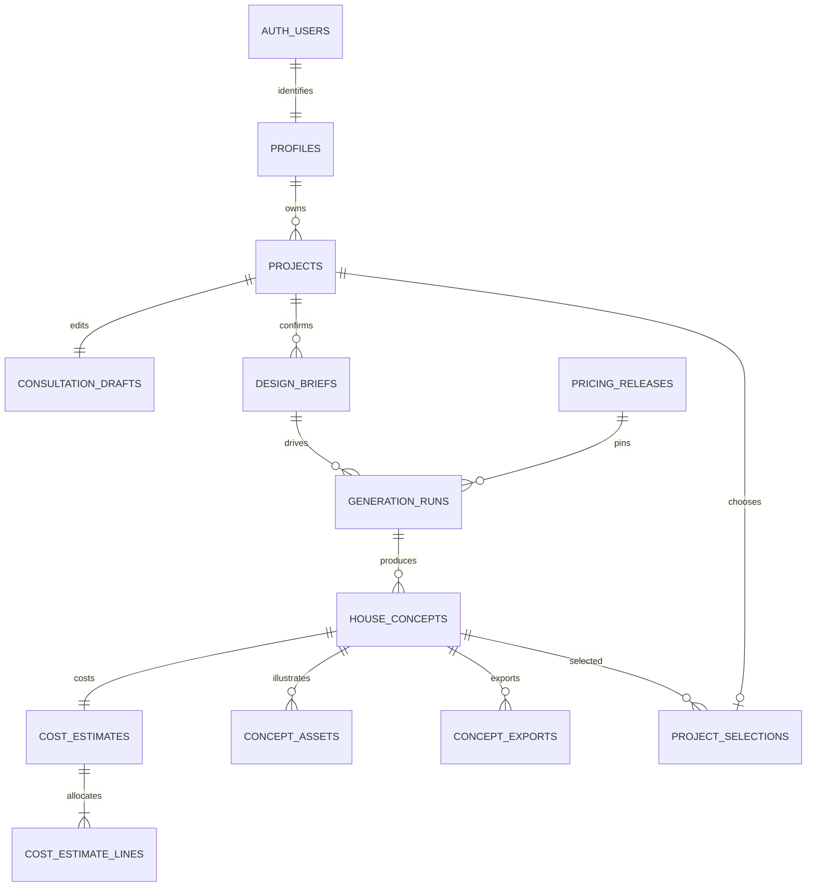

# SmartHouse Project Report

## Personalised Architectural Consultation and Concept Planning

**FivePlusOne Devs**  
**CSC 312 Software Engineering Group Project**  
**University of the Western Cape**  
**Implementation baseline: 6 November 2026**

| Team member | Student number |
|---|---|
| Luvo Goli | 4424259 |
| Lethabo Lethabo | 4141210 |
| Elam Mandulo | 4425757 |
| Lukhanyo Msothwane | 4426268 |
| Samkele Mthuli | 4418450 |
| Chuma Senzangabom | 4425336 |

## Abstract

SmartHouse is a web application that helps prospective homeowners translate site dimensions, household requirements, appearance preferences and an indicative construction budget into an explorable residential concept. The project addresses the difficulty of relating a floor plan to the building it represents and understanding how accommodation choices affect area and cost. A guided consultation produces a reviewed, confirmed brief. A deterministic generator adapts three manually reviewed floor-plan families and produces shared geometry for dimensioned plans, exterior views, an interactive three-dimensional model and indicative costing. The current implementation supports one, two and three storeys, including per-floor plans, aligned stair connections, floor inspection and SVG/JSON downloads. Supabase authentication and PostgreSQL persist accounts, projects, consultation drafts and confirmed briefs; generated geometry and estimates are still regenerated in the browser. Verification recorded during implementation comprises 77 automated tests, 13 isolated database integration checks, static drawing checks, linting and a successful production build. These results support software consistency within the tested scenarios, but do not establish architectural approval, current supplier quotations or user acceptance. Remaining work includes browser and mobile evaluation, professional review, immutable design and estimate persistence, consistent pricing across screens, version comparison and a complete concept package. The project demonstrates an integrated academic prototype without payment or procurement functionality.

**Keywords:** architectural consultation; residential concepts; procedural geometry; floor plans; Three.js; Supabase; software engineering.

## Contents

1. Introduction
2. Evidence and requirements elicitation
3. User model and requirements
4. Development method and software engineering practice
5. System architecture
6. Relational data design
7. Component and algorithm design
8. Interface design and prototype
9. Implementation and project evolution
10. Testing and evaluation
11. Discussion and limitations
12. Remaining development plan
13. Conclusion
14. References
15. Appendices

## 1 Introduction

### 1.1 Background

Planning a home requires several related decisions: the available land, required rooms, circulation between spaces, preferred appearance and an affordable construction scope. A user may recognise an appealing exterior while finding its floor plan difficult to interpret. A plan may also appear suitable until additional bedrooms, a garage or another storey changes its area and estimated cost. SmartHouse connects these decisions in a single consultation and design workspace.

The project began as a house design and cost recommendation system and evolved towards a personalised architectural consultation platform. Its revised proposal emphasises a confirmed brief and a common representation linking layout, visualisation and costing [1]. Subsequent implementation introduced reviewed dataset-derived layouts, more varied building forms, joined roof geometry and multi-storey concepts. This report evaluates that current implementation rather than treating the earlier proposal as a list of completed features.

### 1.2 Problem statement

Prospective homeowners need an understandable way to explore whether their desired accommodation can fit their site and indicative budget. Selecting a catalogue image alone does not explain room relationships, dimensions, circulation or the effect of requested changes. Independently assembled drawings, models and estimates can also describe different buildings. The software problem is therefore to collect a structured brief, derive consistent representations from it and communicate conflicts and assumptions clearly.

The project does not establish that an automatically generated concept is suitable for construction. Structural design, surveyed site information, professional architectural judgement and statutory review remain separate responsibilities.

### 1.3 Aim and objectives

The aim is to develop a personalised architectural planning prototype that converts a homeowner's requirements into an explorable house concept and corresponding indicative cost information.

The objectives are to collect and validate consultation answers; preserve an editable draft and confirmed brief; adapt supported spatial families to room and appearance choices; check selected spatial and budget constraints; derive plans and models from shared geometry; explain estimate quantities and allowances; allow supported revisions; protect owned project records; and provide useful concept exports. A further objective is to evaluate the result through automated checks and subsequent user and domain review.

### 1.4 Scope

The current scope includes rectangular plots, one to six bedrooms, one to four bathrooms, one to three storeys, three reviewed spatial families, three room-size profiles, supported optional spaces and selectable roof forms. Plans include room labels, dimensions, openings and indicative furniture. Interactive exploration includes rotation, zoom, camera presets, roof removal and floor inspection. Costs are displayed in South African Rand.

Payments, checkout, plan purchases, procurement, contractor appointments, arbitrary terrain, unrestricted CAD editing and approved construction drawings are outside scope. Multi-storey support is an extension of the earlier single-storey baseline, not evidence that structural engineering has been implemented.

## 2 Evidence and requirements elicitation

### 2.1 Evidence sources

Requirements were informed by the revised proposal, earlier course submissions, repository specifications, project-owner discussions and the implemented prototype [1-6]. The discussions requested a consultation-led result, actual use of the available floor-plan sources, more varied architecture, better agreement between plans and buildings, and support for double and triple storeys. Screenshots of the application exposed visible roof and presentation problems. These records are stakeholder feedback, not an independent interview or survey study.

The repository provides direct evidence of implementation: questionnaire definitions, generation modules, rendering components, service adapters, SQL and automated tests. Public documentation is used for technical background and attribution. No participant sample, interview result, satisfaction score or architectural endorsement is invented for this report.

### 2.2 Related product review

Maramani was identified by the project owner as a product reference. Its public site organises house plans by area, bedrooms, floors, style and budget, and advertises custom-plan services [7]. These observations informed the desire for a clear house presentation page, navigable design choices and understandable specifications. They do not demonstrate the usability or internal implementation of that service.

SmartHouse's academic focus is the journey from a consultation to a generated concept. Its visual identity uses its own typography, green and neutral palette, layout and controls. No payment flow is implemented. Maramani's advertised commercial offerings are not claimed as SmartHouse capabilities, and the reference does not supply verified construction prices for this project.

### 2.3 Lecturer feedback and response

The annotated Step 5 submission records 26.5/30 for content, 5/10 for report format and 5/10 for the prototype demonstration, giving 37/50 overall [2]. The comments identify missing relational design, a lack of direct application screenshots, formatting problems, the need for subheadings and a clearer demonstration of login and different user types. The lecturer also specifies PDF and MP4 submission rather than ZIP files.

| Feedback concern | Response in the current report and product |
|---|---|
| Relational ERD deferred | Section 6 explains actual Supabase tables, keys, cardinalities and integrity rules. |
| Screenshots absent | Generated-output figures illustrate current geometry; fresh browser screenshots remain a required submission evidence item. |
| Login and user types unclear | Sections 3, 5 and 6 distinguish homeowner access, administrator authority and local demonstration controls. |
| Formatting and subheadings | Numbered chapters and descriptive subsections separate analysis, implementation and evidence. |
| Demonstration and submission format | Appendix C specifies a coherent narrated demonstration and PDF/MP4 deliverables. |

A polished report does not itself close the screenshot or demonstration gap. Actual browser captures and the narrated recording must show the running application and must be checked for private information before submission.

## 3 User model and requirements

### 3.1 Stakeholders and provisional user profiles

The primary user is a prospective homeowner who knows household needs but may have limited experience interpreting drawings. This user needs clear units, manageable questions, visible save status, understandable plan labels and honest cost assumptions. Another likely user is a household comparing alternatives, such as additional accommodation against reduced outdoor space or a higher budget. These profiles guide design; they are not demographic findings.

Administrators maintain authorised platform configuration. Architects, designers and cost practitioners are potential reviewers rather than assumed active users with a completed professional portal. Lecturers assess design quality, implementation, engineering practice and evidence. Team members need modular components and reproducible tests so that changes can be reviewed without relying on visual appearance alone.

### 3.2 Mental model

The interface follows a familiar consultation sequence: describe the land and household, review the brief, confirm it, inspect a proposal and revise supported requirements. A draft is a work in progress. A confirmed brief records the requirements used to generate a concept. A floor plan and a 3D model are different views of that concept. An estimate is an assumption-dependent planning aid.

Keeping these distinctions visible reduces the risk of treating a saved draft as a confirmed design or interpreting a concept preview as an approved plan. The separate design workspace also responds to feedback that long consultation and result pages required excessive scrolling.

### 3.3 Functional requirements and implementation status

Requirement identifiers retain the revised proposal's FR01-FR14 numbering [1,3]. A partial status means implemented behaviour does not yet satisfy the entire target requirement.

| ID | Requirement | Current assessment |
|---|---|---|
| FR01 | Accounts and owned projects | Implemented in the Supabase adapter; full browser acceptance remains pending. |
| FR02 | Guided conditional consultation | Implemented with validation and draft saving. |
| FR03 | Site, budget, spaces and preferences | Implemented for supported fields; some preferences are recorded for review. |
| FR04 | Editable review and confirmed brief | Implemented with versioned confirmation and revision checks. |
| FR05 | Personalised design generation | Implemented within three authored layout families. |
| FR06 | Constraints and explained conflicts | Partial: plot, budget and tested geometry checks exist; comprehensive architectural validation does not. |
| FR07 | Labelled dimensioned plans | Implemented, including per-floor plans. |
| FR08 | Consistent interactive model | Implemented from shared geometry; visual browser evaluation remains necessary. |
| FR09 | Reproducible transparent estimates | Partial: arithmetic is testable, but persisted historical pricing and unified screen calculations remain incomplete. |
| FR10 | Supported revisions | Brief revisions regenerate concepts; previous exact geometry is not permanently captured. |
| FR11 | Save and compare versions | Projects and briefs persist; immutable concept comparison is outstanding. |
| FR12 | Download concept package | Partial: SVG and JSON exist; integrated PDF package remains outstanding. |
| FR13 | Configuration administration | Partial: local demo controls and database role design exist; complete trusted configuration publishing is outstanding. |
| FR14 | Rule and pricing traceability | Partial: generator/source identifiers exist; immutable end-to-end saved snapshots are outstanding. |

### 3.4 Quality requirements

Usability requires labelled fields, visible progress, recoverable errors, readable drawings and an understandable estimate. Reliability requires invalid updates to fail visibly, confirmed briefs to remain immutable and generated geometry to satisfy the tested invariants. Security requires ownership enforcement beyond navigation controls. Maintainability requires consultation, geometry, rendering and costing to remain separate modules. Representation consistency requires every view to consume the same concept data.

Responsive styling and keyboard-oriented controls are implementation intentions, but accessibility conformance and reliable operation on mobile devices require manual evaluation. No measured response-time target or certified quality level is claimed.

### 3.5 Core use case

A homeowner signs in, creates a project and completes the consultation. The application validates answers, saves a draft and presents a review. Confirmation creates a brief version. The generator produces a supported concept, and the homeowner explores its plans, exterior, 3D model and costs. The homeowner may revise the brief and confirm another version, or download the current drawing and concept data.

Alternative flows include incomplete answers, unsupported site information, stale draft revisions, failed saving, unavailable WebGL and a design exceeding the plot or budget. The application must explain these states. A visible concept with a conflict warning must not be described as an affordable or site-approved success.

## 4 Development method and software engineering practice

### 4.1 Iterative development

The proposal adopts a Scrum-oriented iterative process [1]. The available implementation history demonstrates successive increments: catalogue recommendations, local consultation, shared geometry, cloud account/project integration, dataset-derived families, roof corrections and multi-storey support. This supports a description of incremental prototyping. It does not establish that every planned Scrum ceremony, sprint board or formal review occurred.

The prototype is evolutionary code rather than a disposable screen mock-up. Its questionnaire, geometry and renderer were extended as requirements became clearer. This approach allowed the team to expose difficult interactions early, especially between requested rooms, footprint shape, roof surfaces and visual representations.

### 4.2 Principles and methods

User-centred design is reflected in the consultation metaphor, brief review and response to project feedback. Abstraction separates answers from generated geometry. Modular architecture separates storage adapters, layout generation, roof construction, rendering and costing. A shared concept object supports consistency between outputs. Explicit source metadata and allowance labels support transparency.

Methods include use-case analysis, relational modelling, sequence modelling, procedural algorithms, deterministic fixtures and geometry invariants. The current product is rule based. It does not train a neural network to infer architecture from images, and no machine-learning accuracy metric is applicable to its layout generator.

### 4.3 Quality assurance and configuration management

Git records source changes, while automated tests, ESLint and production builds provide repeatable engineering checks. Tests should accompany a requirement or failure mode rather than merely repeat implementation details. Risk review must continue as scope expands, especially when another storey changes stairs, structure, roof exposure, areas and costs together.

The proposal's quality emphasis on usability and reliability is treated as an evaluation framework, not a claim of ISO certification [1,2]. Independent task observation and domain review are still necessary. Team contribution records should be derived from agreed responsibilities and repository evidence rather than retrospectively assigning equal or unsupported contributions.

## 5 System architecture

### 5.1 Active application structure

The frontend uses React, Vite and React Router. SVG components render plans and static building views. Three.js constructs interactive meshes from the generated concept. A service adapter selects the configured persistence mode. In Supabase mode, authentication and project/brief operations use Supabase services. Geometry and current estimates are generated in the browser [4,5].

The repository also retains an Express/PostgreSQL server and local demonstration adapters. Their existence does not mean the current Supabase consultation requires the Express server. Local catalogue records, favourites and demo maintenance remain separate from cloud project persistence.



**Figure 1.** Active consultation architecture. The shared concept is generated in the browser; it is not yet an immutable cloud geometry record.

### 5.2 Component responsibilities

The questionnaire definition and consultation utilities control fields, conditional visibility and supported input validation. Project services handle persistence and revision-sensitive operations. `datasetLayout.js` coordinates family selection and the public concept contract. `sourceLayouts.js` defines single-storey recipes, while `multiStorey.js` constructs the authored multi-level adaptation. `templateGeometry.js` derives boundaries and openings. `architecture.js` and `roofGeometry.js` construct roof surfaces and wall profiles. `houseModel.js` produces Three.js meshes. `estimator.js` calculates quantities, priced lines and allowances. Presentation components consume these results without maintaining a separate room arrangement.

### 5.3 Confirmation sequence



**Figure 2.** Draft saving and confirmation are distinct operations. A stale revision is rejected rather than silently replacing another edit.

### 5.4 Trust boundary

The browser is suitable for interactive previews but cannot be trusted to publish authoritative geometry or prices. Public-client credentials must be limited by ownership policies; privileged database credentials must remain outside frontend configuration. A future trusted generation service must authenticate the caller, verify ownership, load the confirmed brief and save validated geometry and its estimate transactionally. This service is not yet connected.

## 6 Relational data design

### 6.1 Current database and persistence coverage

The Supabase schema uses PostgreSQL tables linked to Supabase Auth identities [5]. The active frontend persists profiles, owned projects, consultation drafts and confirmed briefs. Other tables provide a designed foundation for generated concepts, costs, assets, selections and exports. Their presence in SQL must not be confused with an implemented persistence workflow for those records.

| Table | Key and relationship | Purpose and integration status |
|---|---|---|
| profiles | UUID PK references auth.users | Identity-linked display profile; active account integration. |
| projects | UUID PK; owner_id FK to profiles | Owned active/archived projects; active integration. |
| consultation_drafts | project_id PK and FK | One mutable draft per project; active integration. |
| design_briefs | UUID PK; project_id FK; unique project/version | Immutable confirmations; active integration. |
| pricing_releases | UUID PK; unique version | Immutable rate sets; future trusted snapshot workflow. |
| generation_runs | UUID PK; project/brief/release references | Versioned generation and retry metadata; not connected to browser generation. |
| house_concepts | UUID PK; run and project references | Exact geometry and validation snapshot; not yet saved by the active workflow. |
| cost_estimates | UUID PK; unique concept_id FK | One estimate per saved concept; future integration. |
| cost_estimate_lines | UUID PK; estimate_id FK | Unique category allocations; future integration. |
| concept_assets | UUID PK; concept_id FK | Private visual asset metadata; future integration. |
| project_selections | project_id PK; project/concept FK | Selected concept belonging to that project; future integration. |
| concept_exports | UUID PK; concept_id FK | Export status and private artifact metadata; future integration. |
| private.administrators | user_id PK references auth.users | Trusted administrator membership; not user-editable metadata. |

### 6.2 Entity relationships



**Figure 3.** Relational schema. Downstream generation, estimate, selection and asset relationships are defined in SQL but await active application integration. Constraints restrict selection to the same project; the relationship alone does not express that additional invariant.

### 6.3 Normalisation and JSON documents

Identities, ownership, projects, releases and estimate lines are represented as related records with primary and foreign keys. Uniqueness constraints prevent duplicate brief versions and repeated cost categories. Composite foreign keys prevent a run or concept from referencing another project's brief. Monetary values use numeric database types.

Variable questionnaire answers and rendering geometry use JSONB. Geometry is treated as a versioned document containing rooms, walls, openings, floors and roof regions rather than independent business records edited one at a time. JSONB does not establish architectural correctness: the generator must still validate dimensions, connectivity, overlaps and representation assumptions before a snapshot is trusted.

### 6.4 Ownership and record lifecycle

Projects belong to their authenticated homeowner. Child-resource access follows that ownership through row-level security policies. Supabase documents RLS as a database-level mechanism for restricting rows, complementing the application's authentication [8]. Administrator membership is held in a private table; editing a display name or other user metadata does not confer administrative authority.

Drafts are mutable and revision checked. Confirmation creates an immutable brief. Reconfirming the same revision is idempotent. Archiving is the ordinary project-removal behaviour. The design also includes private asset metadata, but private file lifecycle and cleanup need their own implementation; deleting metadata does not itself prove that uploaded storage objects have been removed.

### 6.5 Integration mismatch requiring resolution

The original database estimate contract checks a rounded area-rate total and five category allocations. The current browser estimator additionally uses material lines and explicit multi-storey allowances. These contracts cannot simply be joined without reconciliation. The trusted persistence increment must update the estimate representation and integrity checks to preserve quantities, line sources, allowances, rounding and the actual displayed total. The prepared multi-storey SQL upgrade widens floor support and validates the storey answer; it does not solve this costing mismatch.

## 7 Component and algorithm design

### 7.1 Dataset preparation and provenance

The available Floor Plans 500 v1 export contains door, window and generic-zone detection labels. The indexed training split contains 837 image variants grouped into 279 source identifiers. A generic zone is not a verified bedroom or bathroom, and image coordinates do not supply a metric scale. The project therefore does not automatically convert all dataset images into usable houses [6].

Three sources were manually reviewed: 649 supplies a linear public/private arrangement, 1115 supplies a split and stepped arrangement, and 979 supplies a broad shared core with service and bedroom wings. Their metric dimensions are authored prototype assumptions. Source images are retained separately from adapted drawings, with file hashes and an attribution manifest. The supplied export declares CC BY 4.0. That licence requires appropriate attribution, a licence link and an indication of changes [9,10].

| Family | Source identifier | Main spatial idea |
|---|---|---|
| Linear living | 649 | Living and kitchen beside a bedroom/service band. |
| Split living | 1115 | Offset rooms, separated bedrooms and a stepped outline. |
| Wide family residence | 979 | Shared central rooms with distinct service and bedroom wings. |

### 7.2 Consultation interpretation and family selection

Inputs include plot dimensions, budget, room counts, number of storeys, finish quality, size profile, kitchen arrangement, layout preference and optional spaces. Compact, Balanced and Generous alter room dimensions. Basic, Standard and Premium alter cost assumptions independently; a premium finish does not automatically enlarge the building or establish a luxury architectural classification.

The generator evaluates the supported families. Best-fit selection prioritises plot and budget fit before declared accommodation suitability and area tie-breaking. An explicit family preference is respected while conflicts remain visible. Optional suites, wardrobes, dining, entertainment and garage accommodation are represented in geometry rather than only listed in a description. Unsupported requirements or an inadequate budget are not resolved by silently deleting requested rooms.

### 7.3 Geometry and circulation

Rooms use finite metric coordinates and rectangular primitives, while their union can create stepped outlines, recesses and separate wings. Boundary extraction identifies exposed wall segments. Door openings are placed on actual shared edges, and windows belong to exposed room boundaries. Private suite rooms connect through the main bedroom. A connectivity graph allows tests to check reachability from the external entrance.

The current generated document uses schema version 6 and generator identifier `source-plans-v6-multi-storey`. Stable identifiers and floor metadata link rooms, walls and openings. The same geometry feeds SVG and Three.js, reducing the opportunity for an attractive exterior to describe a different internal layout.

### 7.4 Multi-storey adaptation

Two- and three-storey plans are authored adaptations of the reviewed families. The source scans do not establish upper-floor layouts or structural members. Social spaces are generally downstairs, while bedrooms occupy upper levels and the main suite is placed on the highest level. Gallery circulation joins a continuous stair core. Upper room plates remain within the occupied plate below, and shorter plates can create setbacks and exposed lower roofs [4].

The nominal floor-to-floor height is 3.2 m. Each stair connection uses 18 risers, two flights, a turning landing, indicative handrails and actual slab openings. Front landings remain outside the openings. Floor graph links include vertical connections. These dimensions describe the prototype; the checks do not constitute a stair, fire-safety or accessibility compliance assessment.

Upper stair openings are deducted from total floor area. Ground footprint, total enclosed floor area and terraces remain separate measures. Multi-storey use can produce surplus flexible accommodation when a small room programme is spread over several levels; the notes disclose this and recommend considering fewer storeys.

### 7.5 Roof and wall construction

The roof algorithm partitions occupied regions into roof sections. Intersecting gables and multi-hip roofs use explicit sloped planes rather than a single roof shape applied to every house. Visible same-level planes are trimmed at intersections, and surface details remain inside the visible patches. Exterior wall tops follow piecewise roof profiles at their actual coordinates. This resolves the earlier visible wall fins passing through roof surfaces.

For multi-storey buildings, upper-floor and terrace coverage is removed from lower roof regions. Different levels retain their own roof elevations, avoiding false full-height closure surfaces between floors. These are conceptual surfaces: structural framing, flashing, valleys, drainage and waterproofing have not been engineered.

### 7.6 Cost calculation

The current estimator combines a floor-area baseline, priced materials and explicit allowances. Catalogue prices are read from the supplied product data when usable; additional benchmark records carry sources and a research date of 3 November 2026. Those stored values are not live quotations. Quantity assumptions include wall openings, generated sloped roof surfaces, ceilings, insulation and indicative slab thicknesses.

Let A be total enclosed floor area, r the finish rate, M the priced material subtotal, U the upper-floor area and n the number of stair connections. The authored upper-storey allowance is S = 1,800U + 25,000n, in Rand. The displayed detailed estimate is T = max(round(Ar), M) + S. The remaining general allowance is G = T - M - S. Therefore M + S + G must reproduce T. The structural and staircase rates are prototype allowances, not supplier or engineering quotations.

For an arithmetic illustration, A = 200 m2, U = 100 m2, r = R9,500/m2, M = R800,000 and n = 1 produce an area baseline of R1,900,000, S = R205,000 and T = R2,105,000. The general allowance is R1,100,000. These assumed inputs demonstrate the equation; they are not a measured building or a market estimate.

Candidate selection and some consultation summaries still use the area-based concept total, while the final detailed page can use the larger material-based result. Unifying those calculation paths is necessary before affordability statements are consistent throughout the workflow.

### 7.7 Procedural outline

```text
SAVE_DRAFT(project, expectedRevision, answers)
    authenticate and verify project ownership
    validate answer structure
    reject an outdated revision
    save answers and increment revision
    return saved revision

CONFIRM_BRIEF(project, savedRevision, acknowledgement)
    verify ownership and current draft revision
    validate required and conditional answers
    reject missing acknowledgement or unsupported required values
    return existing confirmation for this revision if present
    create immutable brief with the next project version

GENERATE_CONCEPT(confirmedAnswers)
    default a missing storey count to one
    validate supported numeric choices
    adapt each supported source family
    derive boundaries, openings, stairs and roof surfaces
    calculate areas and supported conflict indicators
    select the explicit preference or ranked best fit
    return one shared concept with alternatives and assumptions
```

The outline separates persisted brief operations from browser generation. It is not a claim that the current generator performs unrestricted optimisation or exhaustively proves architectural feasibility.

## 8 Interface design and prototype

### 8.1 Consultation and review

The consultation groups related questions, displays units and uses conditional follow-ups. Review makes the recorded answers and assumptions available before confirmation. Existing briefs without a storey field remain single-storey, protecting older projects from a silent scope change. Editing and confirming a new brief is the supported route to requesting more levels.

The design workspace separates exploration from form editing. A household can inspect the current concept, then return to the brief for supported revisions. This preserves the consultation mental model and reduces the need to navigate a long combined form and result page.

### 8.2 House presentation and interaction

The result page provides a building summary, room specifications, total floor area, storey count, budget feedback, source information and estimate detail. Views include front, side, perspective, floor plan, interactive 3D and interior inspection. Plans show room names, dimensions, door swings, windows and shared indicative furniture.

Multi-storey controls select a floor and show its area. The room table identifies each room's level. The 3D viewer can restore the whole building or inspect a selected floor by hiding higher levels, removing the roof and lowering the selected walls. Camera presets, rotation and zoom support exploration. Static views provide an alternative when WebGL is unavailable.

### 8.3 Exports and visual evidence

The implemented downloads include a selected-floor SVG, a combined all-floor sheet and the complete concept JSON. The source and adaptation information accompany exports. These exports support inspection and technical handover, but are not the complete brief/views/estimate PDF package promised in the target requirements.

Generated plans and elevations used in this report come from the implemented drawing components. They demonstrate the geometry output, not browser interaction, responsive behaviour or successful login. Final assessment evidence should additionally include direct captures of authentication, project management, consultation review, the live 3D viewport, multi-floor selection and the detailed estimate. Test credentials and private account information must not appear in those captures.

## 9 Implementation and project evolution

### 9.1 Technology choices

The application uses JavaScript modules, React 18, React Router 6, Vite 5 and Three.js. Supabase supplies account services and PostgreSQL-backed project persistence. SVG supports scalable readable plans and exports. Node's test runner covers frontend modules and adapters, Jest covers the retained server tests, and ESLint supports code checks. Dependency ranges are recorded in package manifests; the implementation verification used Vite 5.4.21.

These choices support a browser-delivered prototype and reusable pure geometry functions. They also introduce resource and compatibility concerns: WebGL is not universally available, large bundles affect startup and browser-generated data is not a trusted database snapshot.

### 9.2 Evolution from the earlier submission

| Area | Earlier Step 5 baseline | Current implementation |
|---|---|---|
| Identity and storage | Local browser records; no active login | Supabase authentication and owned project/brief persistence. |
| Layout generation | One adaptable spatial pattern | Three manually reviewed source families with explicit adaptations. |
| Spatial variety | Limited fixed components | Size profiles, optional suites and rooms, stepped forms and separate wings. |
| Roofs | Simplified schematic construction | Joined gable/hip surfaces and wall profiles derived from shared geometry. |
| Floors | Single storey | One, two or three storeys with aligned stairs and individual plans. |
| Costs | Illustrative area rates | Material lines, recorded benchmarks and separate upper-storey allowances. |
| Verification | Earlier small prototype suite | Expanded engine, authentication, adapter and isolated SQL verification. |
| Saving geometry | Regenerated from stored answers | Still regenerated; immutable geometry/estimate persistence remains incomplete. |

### 9.3 Architectural corrections

Project feedback challenged an earlier design that looked like repeated basic house boxes and did not sufficiently reflect its source plans. The response introduced separate family recipes and explicit additions. Subsequent screenshots exposed wall geometry protruding through intersecting roofs. The correction moved wall heights to actual piecewise roof profiles and trimmed visible roof surfaces. Polygon-aware area calculation also corrected roof costing for clipped and hip polygons.

These changes illustrate why visual review and numerical checks must complement each other. Finite mesh coordinates alone cannot prove that a roof looks architecturally coherent. Conversely, a plausible rendered image does not establish valid openings, room connectivity or reconciled quantities.

## 10 Testing and evaluation

### 10.1 Verification method

Verification combines behavioural tests, geometry invariants, adapter tests, isolated PostgreSQL checks, static drawing renders, linting, production builds and a limited hosted API smoke test. The results below were recorded during the implementation work preceding this report. They are not a new browser acceptance study or an independently audited test certificate.

| Check | Recorded outcome | What it establishes |
|---|---|---|
| Prototype and catalogue tests | 32 passed | Supported workflow, source preparation, geometry, roof and multi-storey invariants. |
| Supabase adapter tests | 9 passed | Adapter behaviour and answer preservation under test conditions. |
| Authentication tests | 7 passed | Tested account/session handling behaviours. |
| Retained server tests | 29 passed | Legacy server logic remains covered; not proof of the active browser journey. |
| Isolated database checks | 13 passed | Actual SQL constraints, policies, triggers and integrity behaviour in a local test cluster. |
| Static multi-storey SVG renders | 39 produced and checked | Server-rendered drawing output for representative families and levels. |
| Lint and production build | Passed | Source checks and successful production bundling. |
| Hosted three-storey brief smoke | Passed | Valid answers saved, confirmed and reopened through the cloud adapter. |

The automated test total is 32 + 9 + 7 + 29 = 77. The 13 database checks and 39 static drawing outputs are separate evidence categories and are not added to that test total. A server-test worker shutdown warning was observed, and Vite reported large output chunks; successful completion does not imply warning-free execution.

### 10.2 Geometry coverage

The single-storey matrix covers 432 combinations of families, room counts, size profiles and feature sets. Multi-storey checks cover 648 combinations: two level counts, three families, three bedroom counts, three bathroom counts, three size profiles, two feature sets and two kitchen arrangements. Matrix combinations are iterations within tests, not hundreds of independently named test cases.

Checks include requested room counts, same-floor non-overlap, finite dimensions, entrance reachability, private suite access, exterior bedroom windows, aligned stair cores, nominal stair dimensions, slab openings, summed floor areas and finite meshes. Model inspection checks verify visibility changes and roof restoration. Upper-room support assertions sample defined points against the lower occupied plate; they do not calculate loads or certify structural support. The corresponding-tread clearance assertion is also narrower than a full headroom assessment along an actual travel path.

### 10.3 Database and cloud checks

The isolated SQL runner creates a temporary local PostgreSQL cluster and emulates the database interfaces needed for the schema. It exercises ownership, role escalation prevention, immutable records, revision conflicts and estimate integrity. The additive multi-storey upgrade is tested for repeated application. This is not a hosted Storage or hosted Auth service test.

A separate hosted check signed in with an authorised test account, created a temporary QA project, saved a three-storey brief, confirmed it and reopened it. The returned answer generated three floors and two stair connections. The temporary project was archived afterward. This establishes the checked cloud data path while preserving the user's existing projects; it does not prove that a person can complete the same journey in the browser.

### 10.4 Browser acceptance and domain evaluation

Comprehensive browser interaction was not completed because the browser-control host was unavailable during verification. HTTP responses and static SVG rendering cannot substitute for clicking controls, testing focus, rotating a live WebGL scene or checking touch interaction. No measured mobile usability, task completion rate or accessibility conformance is claimed.

The next evaluation should ask representative users to create a project, complete a consultation, explain a plan and estimate, change the storey count and export the result. Record task completion, errors, requests for assistance and interpretation of limitations. A designer should review spatial proportions, circulation and roof composition; a cost practitioner should review quantities and allowances. Consent, anonymised records and a defined protocol should precede participant evaluation.

## 11 Discussion and limitations

### 11.1 Objectives achieved

SmartHouse demonstrates the main consultation-to-concept interaction with substantially more personalisation than the earlier single-pattern prototype. Shared geometry links internal arrangement, openings, exterior surfaces and visual views. Multi-storey support extends this representation to floor elevations, stairs and openings rather than only changing a label. Cloud persistence supports account-linked project and brief continuity.

The implementation also provides concrete evidence of engineering separation: adding another storey required coordinated changes to geometry, views, quantities and validation without replacing the entire application. The test matrices help protect supported combinations from regressions.

### 11.2 Remaining technical limits

Only three source families are usable recipes. Other indexed images are an inventory for review. The generator uses authored dimensions and rectangular room primitives; it does not infer room semantics or exact dimensions from arbitrary images. A deterministic selection among three recipes is not unrestricted architectural search.

Historical concepts can change when the browser regenerates from an old brief using updated code or rates. Full design replay requires immutable geometry, input configuration and estimate snapshots. The database's older estimate contract must also be reconciled with the current material/allowance method before trusted saving is implemented.

### 11.3 Architectural and financial limits

Concept checks do not assess site survey accuracy, ground conditions, foundations, load paths, structural members, fire escape, all accessibility requirements, building services or approval requirements. Gallery sizes and extra flexible rooms may be inefficient. Roof section intersections require professional judgement beyond mesh clipping.

Prices reflect supplied records and dated benchmarks, not guaranteed availability. Some cost categories remain general allowances. The upper-structure and staircase amounts are authored assumptions, and their inclusion can overlap conceptually with broad material and labour allowances until a cost practitioner refines the method. A reconciled arithmetic total therefore does not establish commercial accuracy.

### 11.4 Evidence and performance limits

User feedback in this report comes from the project discussion and lecturer comments. It does not establish wider market demand or measured satisfaction. Practitioner approval has not been obtained. The successful build produces large JavaScript/catalogue outputs, including an approximately 11.4 MB uncompressed catalogue chunk. Device-based load, memory and interaction measurements are needed before setting performance claims.

## 12 Remaining development plan

### 12.1 Complete acceptance evidence

First test the current workflow on desktop and mobile: authentication, project creation, saving/resuming, confirmation, one-to-three-storey changes, camera controls, roof removal, floor inspection and downloads. Include an invalid input, a budget conflict and a save/revision error. Capture genuine screenshots, record actual results and resolve blocking defects. Follow with targeted keyboard and narrow-screen checks.

### 12.2 Review architectural quality

Review representative small, large and multi-storey concepts for room proportions, gallery efficiency, stair access, privacy, openings, terraces and roof composition. Distinguish an improved concept from a professionally approved design. Use findings to prioritise rule changes, then repeat the affected geometry and visual checks.

### 12.3 Persist consistent versions and prices

Introduce trusted generation and costing behind ownership checks. Save the exact brief reference, complete geometry, schema/generator configuration, material quantities, source prices and allowances as an immutable version. Reconcile the SQL estimate contract first. Save the concept and complete estimate in one transaction and use request keys to make retries safe. Reopening should render the saved geometry rather than regenerate it silently.

Use the same estimate result in consultation review, alternative ranking and the final page. Keep ground footprint distinct from total floor area and show any budget overrun against the exact displayed total. New rate releases should affect new calculations without changing historical versions.

### 12.4 Finish comparison and deliverable packages

Add a comparison view for saved concepts, identifying changes to accommodation, area, storeys, fit and cost. Build the concept PDF package from one saved version and include the brief, all-floor plans, selected views, estimate basis, source attribution and review limits. Validate every page of the export before marking it ready.

### 12.5 Prepare release and academic submission

Apply the tested additive database upgrade through an authorised administrator, optimise large frontend assets, document environment setup and verify the deployed origin's authentication redirects. Then rehearse the assessment journey and prepare the report PDF and narrated MP4. No deployment success or final user acceptance is claimed until those actions are completed and evidenced.

## 13 Conclusion

SmartHouse has progressed from a local recommendation and consultation prototype to an account-linked architectural concept workspace with three reviewed layout families and one-to-three-storey output. Its strongest implemented contribution is the common geometry connecting plans, modelled spaces, roof surfaces, openings and cost quantities. Automated tests and isolated database checks provide evidence for selected software behaviours and supported geometric invariants.

The original target is only partially complete. Permanent geometry and estimate versions, unified pricing, comparison, full concept packages, browser acceptance and professional review remain necessary. The project is therefore best assessed as an implemented, tested academic prototype with explicit limits. It supports early discussion of a proposed home while preserving the need for qualified architectural, structural and cost review.

## 14 References

[1] FivePlusOne Devs. 2026. SmartHouse Revised Project Proposal. CSC 312 project document. Repository: `docs/SmartHouse_Revised_Project_Proposal.md`.

[2] FivePlusOne Devs. 2026. SmartHouse User Model and Requirements Analysis Design Model and Prototype. Step 5 submission, 11 October 2026, with lecturer annotations. Repository: `docs/Step5_FivePlusOneDevs.pdf`. Feedback reviewed 6 November 2026.

[3] FivePlusOne Devs. 2026. Software Requirements Specification. Repository: `docs/REQUIREMENTS.md`. Target requirements read alongside current implementation updates.

[4] FivePlusOne Devs. 2026. Multi-storey Concepts. Repository: `docs/MULTI_STOREY.md`, `client/src/demo/multiStorey.js`, `datasetLayout.js`, `houseModel.js` and `client/tests/prototype.test.cjs`.

[5] FivePlusOne Devs. 2026. SmartHouse Supabase Database. Repository: `supabase/README.md`, `supabase/schema.sql`, `supabase/upgrade-multi-storey.sql` and `client/src/services/supabaseProjects.js`.

[6] FivePlusOne Devs. 2026. Dataset-derived House Concepts and Attribution Manifest. Repository: `docs/DATASET_TEMPLATES.md`, `client/public/floor-plan-references/attribution.json` and `client/Floor_plan_dataset/catalog.json`.

[7] Maramani. Ready Made or Custom House Floor Plans and Designs. https://www.maramani.com/. Accessed 6 November 2026. Public product reference only.

[8] Supabase. Row Level Security. https://supabase.com/docs/guides/database/postgres/row-level-security. Accessed 6 November 2026.

[9] Roboflow Universe. Floor Plans 500 Dataset Version 1, workspace umair-ab9ex, project floor-plans-500-xqdyk. https://universe.roboflow.com/umair-ab9ex/floor-plans-500-xqdyk/dataset/1. Dataset identification and declared licence verified from the supplied export and attribution manifest; the public dataset page was unavailable during the report review.

[10] Creative Commons. Attribution 4.0 International. https://creativecommons.org/licenses/by/4.0/. Accessed 6 November 2026.

[11] FivePlusOne Devs. 2026. Material Price Benchmarks and Cost Estimator. Repository: `client/src/demo/material_price_benchmarks.json`, research date 3 November 2026; `client/src/demo/estimator.js`; `smart_house_products.json`. Stored planning inputs, not refreshed supplier quotations.

[12] FivePlusOne Devs. 2026. Verification Sources. Repository: `client/tests/prototype.test.cjs`, `floor-plan-catalog.test.cjs`, `supabase.test.cjs`, `auth.test.cjs`, `server/tests` and `supabase/tests/verify.cjs`. Recorded implementation checks described in Section 10.

## 15 Appendices

### Appendix A Reproduction commands

From the repository root, install the project dependencies with `npm install`. Configure the ignored root environment file for the intended mode using the example variable names. Never place a service-role secret in a Vite variable. Start the frontend with `npm run dev` and use the URL printed by Vite. These commands describe how to reproduce checks; the report does not claim a fresh execution merely by listing them.

```text
npm run test:prototype
npm run test:supabase
npm run test:auth
npm test
node supabase/tests/verify.cjs
npm run lint
npm run build
```

`npm run check:supabase` provides a separate hosted connection check when configured. Its credentials belong in local ignored configuration, never this report. The isolated SQL test uses a temporary database rather than a hosted project. Existing database installations use the additive upgrade, not a rerun of the bootstrap schema.

### Appendix B Acceptance evidence record

| Scenario | Required observable result | Evidence status |
|---|---|---|
| Login and homeowner access | Successful session and only owned project records | Automated/API checks recorded; fresh browser capture pending. |
| Different user authority | Homeowner cannot grant self administrator rights | Isolated SQL checks recorded; browser demonstration pending. |
| Save and resume | Saved answers survive reopening | Automated and cloud data checks recorded. |
| Confirm and revise | Confirmation is versioned; stale updates fail | Automated checks recorded. |
| Two and three storeys | Matching level count, connected stairs and per-floor drawings | Geometry/model checks recorded; live interaction pending. |
| Roof inspection | Roof removal and floor visibility preserve model contents | Model assertions recorded; WebGL browser check pending. |
| Budget conflict | Exact overrun and assumptions are understandable | Calculation checks recorded; user interpretation pending. |
| Downloads | Selected/all-floor SVG and JSON agree with the concept | Export implementation/static evidence; full browser download check pending. |
| Mobile and keyboard | Controls remain usable and drawings inspectable | Manual evaluation pending. |
| Professional review | Documented spatial and cost findings | Not yet completed. |

### Appendix C Demonstration and final submission

The earlier Step 5 instructions describe a narrated MP4 with a three-minute maximum [2]. Confirm the current assessment brief before recording, since that earlier limit may not govern a later submission. Demonstrate one coherent project: sign in, create or reopen a project, complete and confirm a brief, inspect the matching plan and 3D output, change to multiple storeys, explain the estimate and download the result. Demonstrate user authority with a prepared authorised account if required; do not imply a local demo rate control is a trusted cloud administration console.

The final evidence set should contain direct screenshots with captions identifying the task and result, the current report PDF, the requested narrated MP4 and any separately required academic forms. The lecturer's recorded instruction is to submit PDF/MP4 files rather than a ZIP. The report does not include an unverified contribution declaration or fabricated participant results. Individual contribution details and any institution-required declaration must be confirmed by the team before submission.
