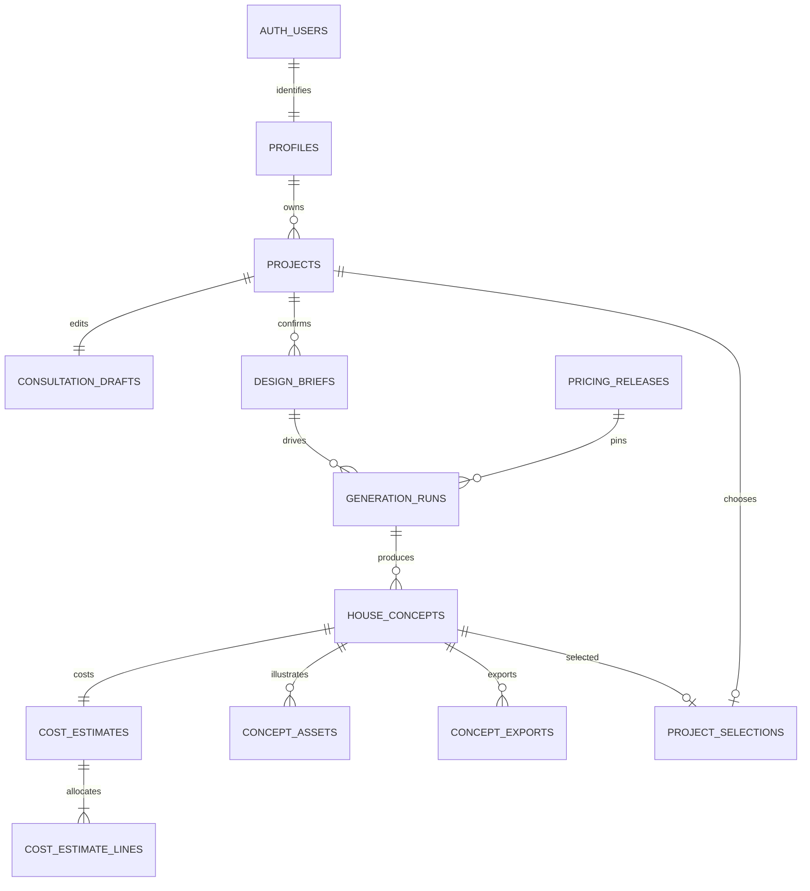

# SmartHouse Supabase database

This schema supports consultation -> confirmed brief -> personalised house page,
including floor plans, 3D geometry, galleries, construction estimates and exports.
There are no payments, orders or checkout tables.

## Install

1. Create a **new Supabase project**. Supabase creates the PostgreSQL database and
   `auth.users`; do not run `CREATE DATABASE` or the legacy server schema.
2. Open **SQL Editor**, paste all of [schema.sql](schema.sql), and run it once.
   It is transactional and deliberately fails on existing conflicting tables rather
   than silently treating an incompatible schema as installed. Do not rerun after
   a successful installation. This is standalone setup SQL, not a CLI migration.
3. Optionally run [storage.sql](storage.sql) once for private galleries/downloads.
   Existing unrelated Storage policies are not replaced: review them for broad
   access before storing user files. Keep the `private` schema OUT of exposed schemas.
4. Create users through Supabase Auth. A trigger creates their profile; users that
   already exist at installation are backfilled. Configure Auth redirect URLs and
   email confirmation for your development environment.
5. To make a registered user an administrator, run in SQL Editor:

```sql
insert into private.administrators(user_id)
select id from auth.users where email = 'your-team-email@example.com'
on conflict do nothing;
```

Verify the SELECT found the intended user. Remove this membership to revoke admin
access. `my_role()` returns the current authenticated user's role; user metadata
cannot grant privileges. An admin can publish pricing releases but cannot browse
other homeowners' projects. SQL Editor/service-role access is privileged.

## Tables and relationships

| Table | Purpose |
|---|---|
| `profiles` | Display name linked to Supabase Auth; no passwords or duplicated email. |
| `projects` | Homeowner-owned project, title and active/archive state. |
| `consultation_drafts` | One mutable answer set per project, with revision counter. |
| `design_briefs` | Immutable confirmed answer snapshots and site/budget information. |
| `pricing_releases` | Immutable complete Basic/Standard/Premium rate sets. |
| `generation_runs` | Generator/configuration version, pinned pricing, retries and diagnostics. |
| `house_concepts` | Versioned house specifications and the exact shared room/door/window geometry. |
| `cost_estimates` | One estimate per concept, with budget, finish, pricing basis and exclusions. |
| `cost_estimate_lines` | Structure, finishes, services, professional fees and contingency allocations. |
| `concept_assets` | Private front/side/perspective images, floor plans and optional 3D files. |
| `project_selections` | The concept selected for the project's final house page. |
| `concept_exports` | SVG/JSON/PDF generation status and private file metadata. |
| `private.administrators` | Administrator membership, editable only through trusted SQL. |



UUID keys reference actual Auth identities. Composite foreign keys prevent mixing
briefs, generator runs, releases and concepts across projects. Geometry is JSONB
because it is a versioned rendering document containing variable room/opening
arrays, not a set of independent editable business records. The generator must
validate room dimensions, connectivity, non-overlap, openings, plot orientation
and site-fit assertions before saving; SQL validates the document envelope, not
architectural feasibility. Store rule/component versions and coordinate convention
in `generation_runs.configuration`, and unsupported needs in the specification.

## Frontend operation contract

The current React application still uses localStorage. Creating these tables does
**not** connect it to Supabase or import local/legacy records. Auth and the service
adapter must be implemented next; legacy numeric IDs are not Supabase UUIDs.

Use the Supabase client with the publishable key and a signed-in session:

```js
// Defaults assign the signed-in owner; a trigger creates the empty draft.
await supabase.from('projects').insert({ title: 'Our family home' }).select().single();

await supabase.rpc('save_consultation_draft', {
  p_project_id: projectId,
  p_expected_revision: revision,
  p_answers: answers, // existing consultation.json question keys, numbers as numbers
});

await supabase.rpc('confirm_design_brief', {
  p_project_id: projectId,
  p_draft_revision: savedRevision,
  p_acknowledged: true,
});
```

Check each returned `error` before continuing. Revision conflicts return SQLSTATE
`40001`: reload/reconcile, do not silently overwrite. Confirming the same revision
is idempotent. Saving again creates a new revision even if answers are unchanged.
Drafts can be incomplete. Confirmation checks required/conditional fields, numeric
room counts and supported choices; the frontend still validates lengths/ranges and
provides field-specific messages. Questionnaire version 1 matches the current
prototype. Version its validator and contract when adding questions or choices.

Users may rename/archive projects, change their own name, and select concepts.
They cannot change ownership, assign roles, edit confirmed snapshots, or write
generated geometry/estimates directly. Anonymous visitors have no application-table
access. Account deletion cascades project data; ordinary project removal is archive.
Storage objects need a separate trusted cleanup job after account deletion; metadata
foreign keys do not delete files through the Storage API.

## Trusted generation and costing

A future backend/Edge Function must authenticate the caller, verify the requested
project owner and active state, load the confirmed brief, and generate the design.
Only then use privileged access to save generated records. **Never put a service-role
key or database password in React/Vite environment variables.** The school prototype
may keep rendering and local downloads in the browser until that backend is connected.

Save each `house_concepts` row, its `cost_estimates` row and all five estimate lines
in **one PostgreSQL transaction** through a backend connection or a purpose-built
transactional RPC. Separate Supabase `.insert()` requests are separate transactions
and will fail the deferred integrity checks. The generation run may be created first
and marked running; complete it in the same transaction that saves its options.
Use a stable request key for retrying the same generation request, and serialize
version allocation by locking the project row before computing the next version.

The database checks the estimate area/budget/finish against the concept and brief,
the rate against the pinned pricing release, and the whole-Rand total against
`round(area * rate)`. Exactly five unique cost categories must sum to that total.
The current demo split is 45% structure, 25% finishes, 15% services, 5% professional
fees and 10% contingency; absorb rounding into structure. These are illustrative
allocations, not bills of quantities or verified market prices. New rate releases
must not overwrite earlier releases or reprice historical concepts.

Assets should use paths such as `<project UUID>/<concept UUID>/front.webp`. Upload
via the Storage API with a unique path, then record the metadata. Download using
authenticated Storage requests or short-lived signed URLs. Publish no real private
household details in a publicly accessible bucket.

## Verification

Run `node supabase/tests/verify.cjs` to create an isolated local PostgreSQL test
cluster using the repository's embedded PostgreSQL dependency. It emulates the
minimal Supabase Auth/Storage database interfaces and exercises the actual SQL,
RLS, triggers, revision conflicts, role escalation and estimate integrity. It does
not connect to Supabase, run hosted Auth, or call the hosted Storage API.

After applying the SQL to Supabase, also run [verify.sql](verify.sql) in SQL Editor.
It checks the installed table/policy/function security configuration. Before frontend
integration, repeat user A/user B and private-download checks with actual sessions.

Official references used:
- [Supabase user profiles](https://supabase.com/docs/guides/auth/managing-user-data)
- [Row-level security](https://supabase.com/docs/guides/database/postgres/row-level-security)
- [Database functions](https://supabase.com/docs/guides/database/functions)
- [Private Storage policies](https://supabase.com/docs/guides/storage/security/access-control)
